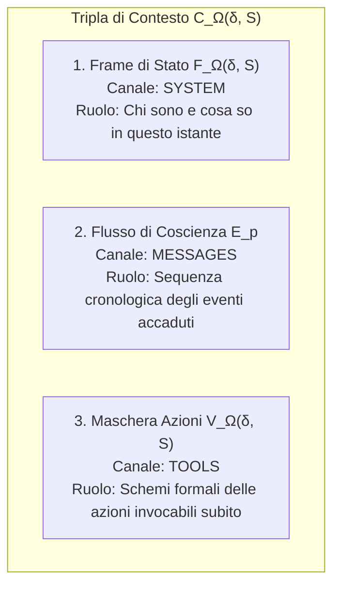

# 1.9 La Funzione di Proiezione del Frame di Stato ($\mathcal{F}_\Omega$) e il Contesto di Inferenza

Questo documento formalizza la proiezione deterministica dello stato interno dell'agente nel canale di sistema (System Frame) e definisce la struttura completa della tripla di contesto inviata al Modello di Linguaggio ad ogni passo computazionale.

---

## 1. La Tripla di Inferenza Fondamentale

A qualsiasi passo decisionale (stimolato da una direttiva $\delta \in \Delta$), l'Orchestratore $\Omega$ assembla e trasmette al Modello di Linguaggio un contesto rigorosamente tripartito:

$$\mathcal{C}_\Omega(\delta, S) = \Big\langle \mathcal{F}_\Omega(\delta, S), \ E_p, \ \mathcal{V}_\Omega(\delta, S) \Big\rangle$$

* **$\mathcal{F}_\Omega(\delta, S)$ (System)**: Proiezione aggiornata in tempo reale dello stato dell'agente. Non viene appesa come messaggio cronologico, ma funge da ancoraggio ontologico.
* **$E_p$ (Messages)**: Sequenza temporale unica, ordinata e priva di snapshot duplicati (user, thought, call, result, summary, directive).
* **$\mathcal{V}_\Omega(\delta, S)$ (Tools)**: Array di contratti JSON Schema corrispondenti alle sole azioni lecite autorizzate al passo corrente.

---

## 2. Definizione Formale della Funzione di Proiezione ($\mathcal{F}_\Omega$)

> **Definizione**: La funzione di proiezione $\mathcal{F}_\Omega$ mappa la direttiva corrente $\delta$ e lo stato $S = \langle I, M_s, D_s, T_a, K_a, E_p \rangle$ in una struttura dichiarativa impaginata per il canale di sistema.

$$\mathcal{F}_\Omega: \Delta \times \mathcal{S} \longrightarrow \mathcal{Frame}_{system}$$

La funzione è definita per casi in base alla fase computazionale dell'automa:

$$\mathcal{F}_\Omega(\delta, S) = \begin{cases}
\langle I, \ M_s, \ D_s, \ K_a, \ \text{Descrittori}(T_a) \rangle & \text{se } \delta \in \{\delta_{start\_intro}, \delta_{loop\_intro}\} \\
\langle I, \ M_s, \ D_s, \ K_a \rangle & \text{se } \delta = \delta_{start\_exec} \\
\langle I, \ M_s, \ \text{Firma}(\sigma_{target}), \ \text{Diagnostica}(\text{err}) \rangle & \text{se } \delta = \delta_{err\_schema}(a_{target}, \text{err})
\end{cases}$$

---

## 3. Analisi della Proiezione per Fase

### 3.1 Fase Introspettiva ($\delta \in \{\delta_{start\_intro}, \delta_{loop\_intro}\}$)
In questa fase l'agente deve allineare la propria mente e configurare le proprie risorse prima di agire:
* **Identità Assoluta ($I$)**: Regole sistemiche e perimetro invalicabile.
* **Missione ($M_s$)**: L'obiettivo a breve termine attuale (valuta se aggiornarlo tramite `aggiorna_missione`).
* **Dati Strutturati ($D_s$)**: Parametri di business e contesto noto.
* **Buffer Concetti Attivi ($K_a$)**: Testo integrale delle schede concettuali attualmente caricate (permette di decidere se cercare o scaricare concetti).
* **Descrittori dei Tool Montati ($\text{Descrittori}(T_a)$)**: Elenco sommario degli strumenti fisici attualmente nel toolbelt, necessario affinché l'agente sappia se eseguire `carica_tool` o `scarica_tool`.

### 3.2 Fase Esecutiva Ordinaria ($\delta = \delta_{start\_exec}$)
L'agente deve interagire con il mondo fisico o concludere:
* Il frame proietta $I, M_s, D_s, K_a$.
* In questa fase, i concetti attivi $K_a$ fungono da **guida operativa e vincoli di business** a testo pieno, orientando l'agente nella scelta dei parametri da inviare ai tool in $T_a$ o all'uscita in $A_{term}$.
* I descrittori dei tool vengono omessi dal frame testuale poiché i tool $T_a \cup A_{term}$ sono già integralmente descritti tramite schemi formali nel canale $\mathcal{V}_\Omega$.

### 3.3 Fase di Errore di Schema ($\delta = \delta_{err\_schema}$)
L'attenzione computazionale dell'agente viene focalizzata esclusivamente sulla risoluzione dell'invalidità:
* Il frame riduce il rumore secondario ed evidenzia la **Firma formale attesa $\sigma_{target}$** e la **Diagnostica puntuale dell'errore sintattico**.
* Consente all'agente di valutare lucidamente se riemettere i parametri corretti o invocare l'azione speciale di rinuncia $a_{abort\_call}$.

---

## 4. La Funzione del Modello Linguistico ($\mathbb{M}$)

Mentre l'Orchestratore $\Omega$ implementa le leggi fisiche, la memoria e la sicurezza del sistema, il **Modello Linguistico di Ragionamento** è formalizzato come una funzione di trasduzione (scatola nera di inferenza):

$$\mathbb{M}: \mathcal{C}_\Omega \longrightarrow (\text{String} \cup \{\emptyset\}) \times \mathcal{P}(\mathcal{V}_\Omega)$$

Dove:
* Prende in input la tripla fondamentale: $\mathcal{C}_\Omega(\delta, S) = \langle \mathcal{F}_\Omega(\delta, S), \ E_p, \ \mathcal{V}_\Omega(\delta, S) \rangle$.
* Produce deterministicamente o probabilisticamente la risposta:
  $$\mathbb{M}(\mathcal{C}_\Omega) = \langle \text{thought}^?, \ \mathcal{A}_{calls} \rangle$$
  1. $\text{thought}^?$: Eventuale monologo di pensiero interno (CoT).
  2. $\mathcal{A}_{calls}$: Il vettore di chiamate a strumenti rigidamente confinato nello spazio consentito: $\mathcal{A}_{calls} \subseteq \mathcal{V}_\Omega(\delta, S)$.

---

## 5. Proprietà di Reattività e Pulizia della Memoria

1. **Aggiornamento Dinamico Istantaneo**:
   Ogni mutazione interna avvenuta al passo $k$ (es. modifica di $M_s$, caricamento di un concetto in $K_a$, montaggio di un tool in $T_a$) si riflette immediatamente nel frame $\mathcal{F}_\Omega$ al micro-step $k+1$.
2. **Invariante di Non-Proliferazione dei Token**:
   Lo stato $S$ non viene mai serializzato o duplicato all'interno del flusso dei messaggi $E_p$. $E_p$ memorizza esclusivamente la storia causale degli eventi ($e$), mantenendo la cronologia lineare, compatta e priva di snapshot ridondanti.

