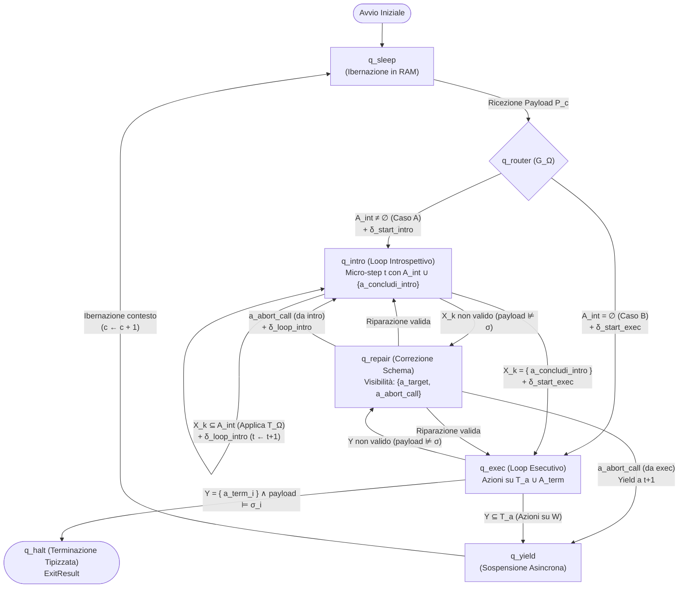

# 1.10 L'Automa a Stati Finiti Globale ($\mathcal{M}_{FSM}$)

Questo documento formalizza il framework come un **Automa a Stati Finiti (Finite State Machine) fortemente tipizzato**, unificando tutte le fasi computazionali, le direttive, le transizioni di yield verso il mondo esterno e l'arresto definitivo (Halt).

---

## 1. Definizione della Macchina a Stati

L'automa è rigorosamente formalizzato come la 6-upla:

$$\mathcal{M}_{FSM} = \langle \mathcal{Q}, \Sigma_{in}, \Sigma_{out}, \Delta_{trans}, q_{sleep}, \{ q_{halt} \} \rangle$$

Dove:
* **$\mathcal{Q}$**: Insieme discreto degli stati macroscopici di controllo:
  $$\mathcal{Q} = \{ q_{sleep}, \ q_{router}, \ q_{intro}, \ q_{exec}, \ q_{repair}, \ q_{yield}, \ q_{halt} \}$$
* **$\Sigma_{in}$**: Spazio degli ingressi ammissibili (Payload compositi $P_c$ e risposte del modello linguistico $\mathbb{M}$).
* **$\Sigma_{out}$**: Spazio delle uscite verso l'ambiente (Azioni asincrone su $W$ e Tagged Union terminale $\coprod A_{term}$).
* **$\Delta_{trans}$**: Funzione di transizione di stato globale governata dall'Orchestratore $\Omega$.
* **$q_{sleep}$**: Stato iniziale di quiete in RAM/storage (in attesa di segnali esogeni).
* **$q_{halt}$**: Stato terminale assorbente (spegnimento definitivo dell'agente).

---

## 2. Diagramma di Transizione degli Stati (State Transition Graph)

---

## 3. Matrice delle Transizioni di Stato ($\Delta_{trans}$)

| Stato Attuale ($q$) | Condizione / Evento di Trigger | Stato Successivo ($q'$) | Azione dell'Orchestratore $\Omega$ |
| :--- | :--- | :--- | :--- |
| **$q_{sleep}$** | Arrivo Payload $P_c$ | $q_{router}$ | Risveglio, $D_s \leftarrow D_s \oplus \Delta D_s$, fusione $E_p \leftarrow E_p \cdot P_c$. |
| **$q_{router}$** | $A_{int} \neq \emptyset$ | $q_{intro}$ | Iniezione $e_\delta(\delta_{start\_intro})$ nel prompt, inizio micro-step. |
| **$q_{router}$** | $A_{int} = \emptyset$ | $q_{exec}$ | Bypassa introspezione, iniezione $e_\delta(\delta_{start\_exec})$. |
| **$q_{intro}$** | $X_k \subseteq A_{int} \land X_k \neq \emptyset$ | $q_{intro}$ | Applica $\mathcal{T}_\Omega(X_k, S)$, accoda risultati $R_k$, inietta $\delta_{loop\_intro}$ ($t \leftarrow t+1$). |
| **$q_{intro}$** | $X_k \not\models \sigma$ (errore schema) | $q_{repair}$ | Blocca esecuzione, isola $\mathcal{V}_\Omega = \{a_{target}, a_{abort\_call}\}$, inietta $\delta_{err\_schema}$. |
| **$q_{intro}$** | $X_k = \{ a_{concludi\_intro} \}$ | $q_{exec}$ | Sigilla memoria introspettiva, revoca $A_{int}$, inietta $\delta_{start\_exec}$. |
| **$q_{exec}$** | $Y \not\models \sigma$ (errore schema) | $q_{repair}$ | Blocca chiamata fisica o terminazione, inietta $\delta_{err\_schema}$. |
| **$q_{exec}$** | $Y \subseteq T_a$ (azioni sul mondo) | $q_{yield}$ | Accoda chiamate in $E_p$, lancia chiamate asincrone a $W$. |
| **$q_{exec}$** | $Y = \{ a_{term\_i} \} \land payload \models \sigma_i$ | $q_{halt}$ | Arresto secco immediato, emissione risultato tipizzato. |
| **$q_{repair}$** | Emissione valida di $a_{target}$ | $q_{intro} \lor q_{exec}$ | Riparazione riuscita: procede con la normale esecuzione della fase. |
| **$q_{repair}$** | Emissione di $a_{abort\_call}$ da $q_{intro}$ | $q_{intro}$ | Consuma il tick $t$, accoda annullamento, inietta $\delta_{loop\_intro}$. |
| **$q_{repair}$** | Emissione di $a_{abort\_call}$ da $q_{exec}$ | $q_{yield}$ | Consuma il macro-ciclo $c$, registra annullamento, va in Yield a $t+1$. |
| **$q_{yield}$** | Dispatch completato | $q_{sleep}$ | Ibernazione del processo in memoria persistente, $c \leftarrow c + 1$. |
| **$q_{halt}$** | - | - | **Stato terminale assorbente**: processo estinto. |

