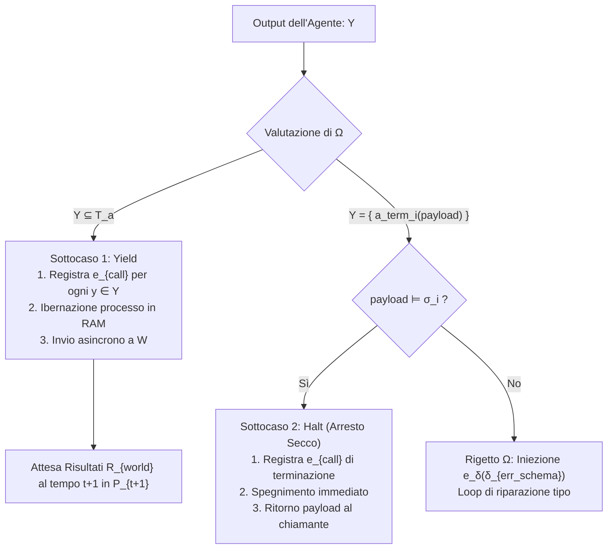

# 1.4 La Fase 2: Il Loop Esecutivo ($\Phi_{exec}$)

La fase esecutiva modella l'interazione concreta dell'agente con il Mondo esterno $W$ e la sua terminazione deterministica.

---

## 1. Configurazione della Fase

Ricevuto il macro-stato $S_t$ consolidato:
1. $\Omega$ rimuove integralmente tutti i permessi cognitivi $A_{int}$.
2. Inietta la direttiva $\delta_{start\_exec}$ (vedi [directives.md](file:///c:/Users/aurel/Desktop/Progetti/Ricerca/Agent/formalization/02_framework/directives.md)).
3. Configura lo spazio operativo:
   $$\mathcal{A}_{exec} = T_a \cup A_{term}$$

Lo stato di lavoro iniziale di questa fase è dato da:
$$S_{t, exec} = S_t \oplus \delta_{start\_exec}$$

---

## 2. Valutazione e Risoluzione dell'Output $Y$

Il modello emette un vettore di azioni esterne $Y$ (eventualmente accompagnato dal proprio messaggio di pensiero $e_{thought}$). $\Omega$ applica rigorosamente due casistiche mutualmente esclusive:

### Sottocaso 1 (Azione sul Mondo - Yield)
* **Condizione**: $Y \subseteq T_a$
* Per ogni strumento fisico $y_j \in Y$, viene registrato il messaggio di chiamata:
  $$e_{call, j} = \langle (t, k), \pi_{agent}, \text{call}, y_j, id_j \rangle$$
* $\Omega$ sospende l'agente in memoria (Yield), iberna il contesto e inoltra le richieste asincrone a $W$.
* **Nessun ulteriore messaggio viene aggiunto in questo ciclo vitale**.
* Al ciclo successivo $t+1$, le risposte del mondo verranno fornite all'interno della sequenza $E_{world}$ del nuovo payload $P_{t+1}$.

### Sottocaso 2 (Terminazione Tipizzata - Halt Secco)
* **Condizione**: $Y = \{ a_{term\_i}(payload) \}$ dove $a_{term\_i} \in A_{term}$.
* Viene registrato il messaggio di richiesta di arresto:
  $$e_{term} = \langle (t, k), \pi_{agent}, \text{call}, a_{term\_i}(payload), id_{term} \rangle$$
* $\Omega$ applica il controllo formale di conformità:
  * **Se valido ($payload \models \sigma_i$)**: l'agente viene **spento istantaneamente con un Halt secco**. Nessun ulteriore messaggio di log o di sistema viene aggiunto a $E_p$; il processo rilascia le risorse e restituisce deterministicamente $payload$ al chiamante.
  * **Se non valido ($payload \not\models \sigma_i$)**: $\Omega$ intercetta l'invalidità, blocca l'Halt e accoda il messaggio correttivo:
    $$e_{err} = \langle (t, k), \pi_\Omega, \text{directive}, \delta_{err\_schema}, \emptyset \rangle$$
    obbligando il modello ad emettere un nuovo tentativo conforme allo schema.

