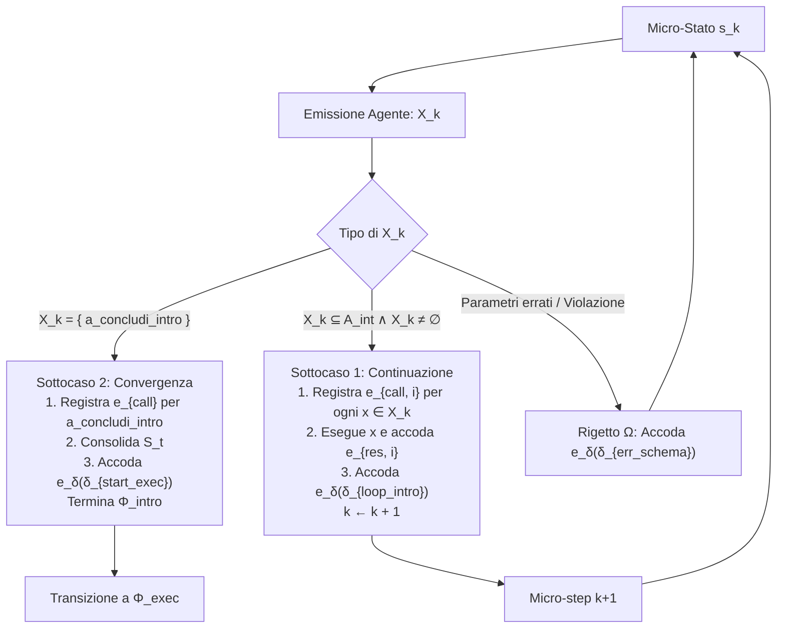

# 1.3 La Fase 1: Il Loop Introspettivo ($\Phi_{intro}$)

Il loop introspettivo formalizza la convergenza epistemologica interna dell'agente. Opera isolato dal mondo esterno, garantendo che nessuna azione fisica venga invocata prima che la mente dell'agente sia allineata.

---

## 1. Modello Matematico del Loop

La funzione evolve per micro-step discreti $k \in \mathbb{N}_0$, dove il numero di passi ammessi è a priori arbitrario/illimitato fino al raggiungimento autonomo della convergenza.

### Stato Iniziale ($k = 0$)
$$s_0 = S_{t-1} \oplus P_t$$
dove $P_t$ contiene già in coda il messaggio di direttiva $e_\delta = \langle (t, 0), \pi_\Omega, \text{directive}, \delta_{start\_intro}, \emptyset \rangle$ generato dal router $G_\Omega$.

---

## 2. Valutazione e Transizione al Micro-Step $k$

Il modello di reasoning riceve lo stato e genera:
1. Eventuale messaggio di riflessione interna: $e_{thought} = \langle (t, k), \pi_{agent}, \text{thought}, \mu_{thought}, \emptyset \rangle$.
2. Vettore di output $X_k$. L'Orchestratore $\Omega$ applica una regola di **mutua esclusione logica (XOR)**:

### Sottocaso 1 (Continuazione Introspettiva)
* **Condizione**: $X_k \subseteq A_{int} \land X_k \neq \emptyset$
* Per ogni azione $x_i \in X_k$, viene accodato il messaggio di chiamata:
  $$e_{call, i} = \langle (t, k), \pi_{agent}, \text{call}, x_i, id_i \rangle$$
* $\Omega$ valida ciascun payload rispetto a $\sigma_{in}$ ed esegue le transizioni cognitive interne.
* Per ciascuna azione eseguita, $\Omega$ accoda il messaggio di risultato:
  $$e_{res, i} = \langle (t, k), \pi_\Omega, \text{result}, R_k^{(i)}, id_i \rangle$$
* $\Omega$ accoda la direttiva di prosecuzione:
  $$e_{\delta, loop} = \langle (t, k+1), \pi_\Omega, \text{directive}, \delta_{loop\_intro}, \emptyset \rangle$$
* Lo stato evolve: $s_{k+1} = s_k \cdot [e_{call}] \cdot [e_{res}] \cdot [e_{\delta, loop}]$ e il micro-step avanza a $k+1$.

### Sottocaso 2 (Convergenza e Chiusura)
* **Condizione**: $X_k = \{ a_{concludi\_intro} \}$
* Viene accodato il messaggio di chiusura atomico:
  $$e_{close} = \langle (t, k), \pi_{agent}, \text{call}, a_{concludi\_intro}, id_{close} \rangle$$
* $\Omega$ interrompe immediatamente il loop introspettivo:
  $$S_t = \text{Consolida}(s_k)$$
* Viene preparato l'ingresso alla fase esecutiva iniettando la direttiva:
  $$e_{\delta, exec} = \langle (t, k), \pi_\Omega, \text{directive}, \delta_{start\_exec}, \emptyset \rangle$$
* La funzione $\Phi_{intro}$ termina e passa il controllo a $\Phi_{exec}$.

---

## 3. Invarianti di Sicurezza di $\Phi_{intro}$

1. **Invariante di Chiusura Fisica**:
   $$\forall k, \quad X_k \cap W = \emptyset$$
   Nessuna operazione verso il mondo esterno può essere tentata in $\Phi_{intro}$.
2. **Invariante di Singolarità di Chiusura**:
   $$a_{concludi\_intro} \in X_k \implies X_k = \{ a_{concludi\_intro} \}$$
   L'azione di chiusura non può essere combinata con alcuna altra operazione.

