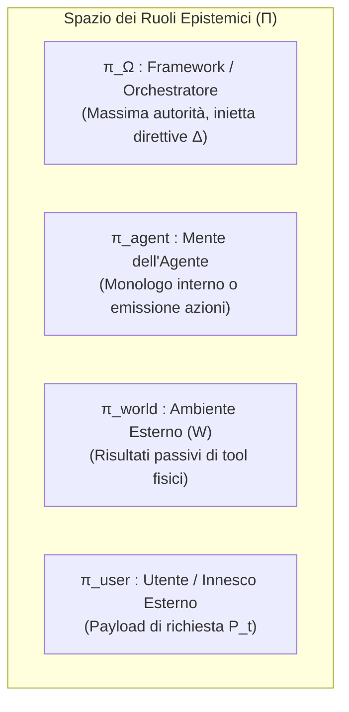

# 1.7 Ontologia dei Messaggi e del Flusso di Coscienza ($E_p$)

Questo documento formalizza la struttura atomica dei messaggi, lo spazio dei ruoli epistemici $\Pi$, e i punti di emissione all'interno del ciclo vitale dell'agente.

---

## 1. Definizione Atomica di un Messaggio ($e$)

Il Flusso di Coscienza $E_p$ non è una sequenza di stringhe grezze, ma un vettore ordinato nel tempo di **eventi di comunicazione e pensiero fortemente tipizzati**:

$$E_p = [e_0, e_1, e_2, \dots, e_n] \in \mathcal{E}^*$$

Ogni singolo evento/messaggio $e \in \mathcal{E}$ è formalizzato come la 5-upla essenziale:

$$e = \langle \tau, \pi, \kappa, \mu, id \rangle$$

| Componente | Simbolo | Dominio / Tipo | Descrizione |
| :--- | :---: | :--- | :--- |
| **Marca Temporale** | $\tau$ | $\mathbb{N}_0 \times \mathbb{N}_0$ | Coppia $\langle c, t \rangle$ indicante il macro-ciclo del mondo $c$ e il tick decisionale $t$ (passo prompt/direttiva). |
| **Ruolo Epistemico** | $\pi$ | $\Pi$ | L'autorità formale della sorgente del messaggio ($\Pi = \{\pi_\Omega, \pi_{agent}, \pi_{world}, \pi_{user}\}$). |
| **Tipo di Canale** | $\kappa$ | $\mathcal{K}$ | La natura del contenuto ($\mathcal{K} = \{\text{thought}, \text{call}, \text{result}, \text{directive}, \text{payload}, \text{summary}\}$). |
| **Contenuto Semantico** | $\mu$ | $\text{String} \cup \text{JSON} \cup \text{ToolCall}$ | Il payload effettivo o la rappresentazione linguistica/strutturata. |
| **ID di Correlazione** | $id$ | $\mathcal{I} \cup \{\emptyset\}$ | Identificativo univoco di pairing per correlare chiamate e risultati. |

---

## 2. Lo Spazio Temporale a Due Dimensioni ($\tau = \langle c, t \rangle$)

Il tempo del sistema è formalizzato da una coppia ordinata che disaccoppia il ritmo computazionale interno dal ritmo transazionale con il Mondo:

1. **$c \in \mathbb{N}_0$ (Macro-Ciclo del Mondo / World Cycle)**:
   * Conta quante interazioni complete col Mondo esterno sono state concluse.
   * Si incrementa di $+1$ ogni volta che l'agente esegue uno Yield sul mondo $W$ e si risveglia con un nuovo payload esogeno $P_{c+1}$.
2. **$t \in \mathbb{N}_0$ (Tick Decisionale / Prompt Epoch)**:
   * Conta ogni singola attivazione del Modello di Linguaggio indotta da una direttiva $\delta \in \Delta$.
   * Cresce monotonicamente ad ogni passo sia in fase introspettiva che esecutiva.

---

## 3. Struttura Composita del Payload del Mondo ($P_c$)

Il Payload di risveglio $P_c$ al macro-ciclo $c$ è la sequenza ordinata:

$$P_c = E_{world} \ \cdot \ E_{user} \ \cdot \ [ \ e_\delta \ ]$$

Dove le risposte del mondo $E_{world}$ possono contenere eventuali aggiornamenti esogeni per i dati strutturati ($\Delta D_s$). In tal caso, l'Orchestratore $\Omega$ applica automaticamente l'unione:
$$D_s \leftarrow D_s \oplus \Delta D_s$$

La direttiva iniziale $e_\delta$ inclusa nel payload assume marca temporale $\tau = \langle c, t \rangle$:
$$e_\delta = \begin{cases} 
\langle \langle c, t \rangle, \pi_\Omega, \text{directive}, \delta_{start\_intro}, \emptyset \rangle & \text{se } A_{int} \neq \emptyset \\ 
\langle \langle c, t \rangle, \pi_\Omega, \text{directive}, \delta_{start\_exec}, \emptyset \rangle & \text{se } A_{int} = \emptyset 
\end{cases}$$

---

## 3. Lo Spazio dei Ruoli Epistemici ($\Pi$)

Definiamo la tassonomia esaustiva dei ruoli nel sistema:

$$\Pi = \{ \pi_{\Omega}, \ \pi_{agent}, \ \pi_{world}, \ \pi_{user} \}$$

### Specifica di Autorità e Privilegio dei Ruoli:

1. **$\pi_{\Omega}$ (Orchestratore / Sistema)**:
   * **Livello di Autorità**: Massimo / Assoluto.
   * **Proprietà**: Non falsificabile dall'agente o dall'utente.
   * **Ruolo nelle API reali**: Corrisponde a `system` o a messaggi iniettati dal control-plane del runtime.
   * **Cosa veicola**: Le direttive di fase $\Delta$ ($\delta_{start\_intro}, \delta_{loop\_intro}, \delta_{start\_exec}$) e gli errori di validazione schema ($\delta_{err\_schema}$).

2. **$\pi_{agent}$ (Agente / Ragionatore)**:
   * **Livello di Autorità**: Cognitivo interno.
   * **Ruolo nelle API reali**: Corrisponde a `assistant` (con blocchi `thought`, `text` e `tool_use`).
   * **Cosa veicola**: Il monologo di pensiero interno (CoT), l'emissione del vettore di azioni introspettive $X_k$, o l'emissione del vettore di azioni esterne/terminazione $Y$.

3. **$\pi_{world}$ (Mondo Esterno $W$)**:
   * **Livello di Autorità**: Passivo / Evidenziale.
   * **Ruolo nelle API reali**: Corrisponde a `tool` (tool response / function output).
   * **Cosa veicola**: Il risultato oggettivo $R_{world} \models \sigma_{out}$ dell'avvenuta esecuzione di un'azione fisica in $W$. Non può contenere direttive di sistema.

4. **$\pi_{user}$ (Utente / Sistema Chiamante)**:
   * **Livello di Autorità**: Input Esogeno.
   * **Ruolo nelle API reali**: Corrisponde a `user`.
   * **Cosa veicola**: Il payload iniziale $P_t$ o messaggi asincroni ricevuti da entità umane o orchestratori esterni.

---

## 4. Lo Spazio dei Canali di Contenuto ($\mathcal{K}$)

Un messaggio non è solo testo, ma possiede una tipizzazione funzionale $\kappa \in \mathcal{K}$:

$$\mathcal{K} = \{ \text{thought}, \ \text{call}, \ \text{result}, \ \text{directive}, \ \text{payload}, \ \text{summary} \}$$

* **$\kappa = \text{thought}$**: Il ragionamento esplicito (Chain of Thought), generato spontaneamente con $\pi_{agent}$ in risposta a qualsiasi direttiva $\delta \in \Delta$.
* **$\kappa = \text{call}$**: L'intenzione formale di invocare una o più funzioni ($X_k$ o $Y$), generata con $\pi_{agent}$.
* **$\kappa = \text{result}$**: La risposta di una funzione eseguita con successo, generata con $\pi_{\Omega}$ (per i tool cognitivi) o con $\pi_{world}$ (per i tool fisici).
* **$\kappa = \text{directive}$**: Un vincolo strutturale o di fase, generato esclusivamente con $\pi_{\Omega}$.
* **$\kappa = \text{payload}$**: L'evento dal mondo scatenante, generato con $\pi_{user}$ o $\pi_{world}$.
* **$\kappa = \text{summary}$**: Messaggio compatto di sintesi epistemica, generato a seguito della primitiva `compatta_memoria`, che sostituisce deterministicamente un intervallo continuo di messaggi $[e_i, \dots, e_j]$ per ottimizzare la context window preservando la causalità storica.

---

## 5. Mappa dei Punti di Creazione dei Messaggi nel Ciclo Vitale

Ecco il tracciato esatto di ogni messaggio aggiunto a $E_p$ durante il ciclo temporale $t$. Si noti come a fronte di **ogni direttiva** ($\delta$), l'agente possa premettere un blocco $\text{thought}$ alla propria chiamata:

| Punto del Grafo | Momento Temporale | Mittente ($\pi$) | Tipo ($\kappa$) | Contenuto ($\mu$) | Descrizione dell'Evento |
| :--- | :---: | :---: | :---: | :--- | :--- |
| **Innesco Risveglio** | $(t, 0)$ | $\pi_{user}$ | $\text{payload}$ | $P_t$ | Arrivo dell'evento esterno scatenante. |
| **Ingresso Intro** | $(t, 0)$ | $\pi_{\Omega}$ | $\text{directive}$ | $\delta_{start\_intro}$ | $\Omega$ impone il blocco dei tool del mondo e apre la riflessione. |
| **Passo Cognitivo $k$** | $(t, k)$ | $\pi_{agent}$ | $\text{thought}^? + \text{call}$ | Pensiero opzionale + $X_k$ | In risposta a $\delta$, l'agente ragiona ed emette le azioni su memoria $X_k$. |
| **Risultato Cognitivo** | $(t, k)$ | $\pi_{\Omega}$ | $\text{result}$ | $R_k$ | $\Omega$ notifica gli esiti delle mutazioni interne. |
| **Rilancio Step $k+1$** | $(t, k+1)$ | $\pi_{\Omega}$ | $\text{directive}$ | $\delta_{loop\_intro}$ | $\Omega$ sollecita un nuovo micro-passo o la chiusura. |
| **Chiusura Intro** | $(t, k_{final})$ | $\pi_{agent}$ | $\text{thought}^? + \text{call}$ | Pensiero opzionale + $\{ a_{concludi\_intro} \}$ | L'agente attesta l'avvenuta convergenza. |
| **Apertura Esecuzione** | $(t, k_{final})$ | $\pi_{\Omega}$ | $\text{directive}$ | $\delta_{start\_exec}$ | $\Omega$ rimuove $A_{int}$, sblocca $T_a \cup A_{term}$ e ordina l'azione esterna. |
| **Emissione Azione** | $(t, k_{final})$ | $\pi_{agent}$ | $\text{thought}^? + \text{call}$ | Pensiero opzionale + $Y$ | In risposta a $\delta_{start\_exec}$, pianifica l'effetto ed emette $Y$. |
| **Feedback Errore Tipo** | $(t, k_{final})$ | $\pi_{\Omega}$ | $\text{directive}$ | $\delta_{err\_schema}$ | Inviato da $\Omega$ se $Y \not\models \sigma$ o $X_k \not\models \sigma$ per forzare l'autocorrezione. |
| **Riparazione Errore** | $(t, k_{final})$ | $\pi_{agent}$ | $\text{thought}^? + \text{call}$ | Riflessione sull'errore + $Y_{corretto}$ | In risposta a $\delta_{err\_schema}$, ragiona sull'errore e riemette l'azione. |
| **Arresto (Halt)** | $(t, k_{final})$ | $\pi_{agent}$ | $\text{call}$ | $a_{term\_i}(payload)$ | L'agente invoca un'uscita valida ($payload \models \sigma_i$). Arresto secco immediato. |
| **Ritorno dal Mondo** | $(t+1, 0)$ | $\pi_{world}$ | $\text{result}$ | $R_{world} \models \sigma_{out}$ | Al risveglio successivo in $P_{t+1}$, arrivano i risultati fisici delle azioni in $W$. |

---

## 6. Distinzione Formale dei Due Livelli di Errore

Il sistema distingue rigidamente la natura degli errori in base all'autorità $\pi$ emittente:

1. **Errore Sintattico / Violazione di Schema ($\Omega$-level)**:
   * **Emittente**: $\pi_\Omega$, canale $\kappa = \text{directive}$.
   * **Causa**: L'agente emette un'azione con parametri non conformi allo schema atteso ($payload \not\models \sigma$).
   * **Effetto**: L'azione non raggiunge né il mondo esterno né la memoria; $\Omega$ intercetta l'invalidità e accoda il messaggio correttivo $\delta_{err\_schema}$.
2. **Errore Applicativo / Runtime del Mondo ($W$-level)**:
   * **Emittente**: $\pi_{world}$, canale $\kappa = \text{result}$, legato all'$id$ di chiamata originario.
   * **Causa**: L'azione era conforme a $\sigma_{in}$ ed è stata eseguita dal mondo $W$, ma l'operazione esterna ha fallito logicamente (es. connessione rifiutata, risorsa non trovata).
   * **Effetto**: Questo non è un errore di controllo di $\Omega$, ma una **reale evidenza empirica passiva** del mondo, strutturata secondo lo schema di ritorno $\sigma_{out}$.

---

## 7. Teorema di Integrità del Flusso (Message Provenance Invariant)

> **Invariante di Non-Falsificabilità**: Sia $e = \langle t_k, \pi, \kappa, \mu, id \rangle \in E_p$.  
> Nessun messaggio con $\pi \in \{\pi_{\Omega}, \pi_{world}\}$ può essere generato da un'invocazione del modello linguistico dell'agente. Solo il runtime di $\Omega$ può apporre tali ruoli a un messaggio.

Questo teorema assicura formalmente che:
1. L'agente non può "allucinare" di aver ricevuto una direttiva $\delta$ da $\Omega$.
2. L'agente non può "auto-dichiarare" che un tool di $W$ abbia avuto successo simulandone l'output come se provenisse da $\pi_{world}$.

