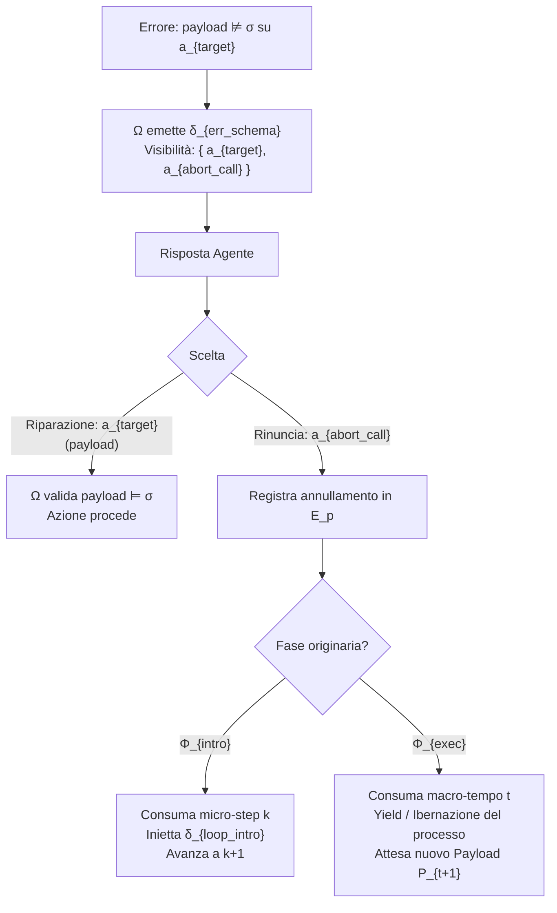

# 1.8 La Funzione di Visibilità delle Azioni ($\mathcal{V}_\Omega$) e l'Azione di Abort

Questo documento formalizza lo spazio delle azioni effettivamente accessibili ed invocabili dal modello in ciascuno stato computazionale, definendo la maschera delle capacità applicata dall'Orchestratore $\Omega$ e la gestione deterministica della rinuncia ad un'azione tramite $a_{abort\_call}$.

---

## 1. Definizione Formale della Funzione di Visibilità ($\mathcal{V}_\Omega$)

> **Definizione**: La funzione di visibilità $\mathcal{V}_\Omega$ mappa la direttiva di controllo corrente $\delta \in \Delta$ e lo stato dell'agente $S$ nel sottoinsieme rigoroso di azioni che il Modello di Linguaggio è autorizzato a visualizzare ed emettere in quel preciso istante.

$$\mathcal{V}_\Omega: \Delta \times \mathcal{S} \longrightarrow \mathcal{P}(\mathcal{A}_{totale})$$

La funzione è definita in modo esaustivo per casi:

$$\mathcal{V}_\Omega(\delta, S) = \begin{cases}
A_{int} \cup \{ a_{concludi\_intro} \} & \text{se } \delta \in \{\delta_{start\_intro}, \delta_{loop\_intro}\} \\
T_a \cup A_{term} & \text{se } \delta = \delta_{start\_exec} \\
\{ a_{target} \} \cup \{ a_{abort\_call} \} & \text{se } \delta = \delta_{err\_schema}(a_{target})
\end{cases}$$

---

## 2. Analisi dei Domini di Visibilità per Fase

### 2.1 Fase Introspettiva ($\delta_{start\_intro}, \delta_{loop\_intro}$)
* **Insieme Visibile**: $\mathcal{V}_\Omega = A_{int} \cup \{ a_{concludi\_intro} \}$.
* **Invariante di Barriera Fisica**:
  $$\mathcal{V}_\Omega \cap (T_a \cup A_{term}) = \emptyset$$
* L'agente può invocare solo le proprie primitive cognitive interne o attestare la convergenza epistemica.

### 2.2 Fase Esecutiva Ordinaria ($\delta_{start\_exec}$)
* **Insieme Visibile**: $\mathcal{V}_\Omega = T_a \cup A_{term}$.
* **Invariante di Sigillatura Cognitiva**:
  $$\mathcal{V}_\Omega \cap A_{int} = \emptyset$$
* L'agente ha accesso esclusivo alle funzioni fisiche operanti sul Mondo $W$ ($T_a$) e ai contratti di terminazione tipizzati ($A_{term}$).

### 2.3 Fase di Errore di Schema ($\delta_{err\_schema}(a_{target})$)
* **Insieme Visibile Confinato**: $\mathcal{V}_\Omega = \{ a_{target} \} \cup \{ a_{abort\_call} \}$.
* **Scopo**: Eliminare qualsiasi digressione o allucinazione di altri strumenti. Il modello è vincolato a una scelta binaria rigida (XOR):
  1. Correggere i parametri dell'azione tentata ($a_{target}(payload_{corretto})$).
  2. Rinunciare formalmente ed esplicitamente all'azione ($a_{abort\_call}$).

---

## 3. L'Azione Atomica Speciale di Rinuncia ($a_{abort\_call}$)

$$a_{abort\_call}(\emptyset)$$

* **Natura**: Azione di controllo atomica $\Omega$-managed priva di parametri ($\sigma_{in} = \emptyset$).
* **Significato Formale**: L'agente riconosce che l'intento originario non è perseguibile o non ha senso logico, e decide di ritirare la chiamata anziché persistere nella riparazione.
* **Principio di Consumo del Turno**: L'emissione di $a_{abort\_call}$ non ripristina magicamente lo stato precedente, ma **costituisce un'azione intrapresa e irreversibile** che consuma il turno decisionale corrente.

---

## 4. Effetti Computazionali e Temporali dell'Aborto

### Caso A: Aborto durante $\Phi_{intro}$ (Micro-step cognitivo)
1. L'agente emette la chiamata di rinuncia:
   $$e_{call} = \langle (t, k), \pi_{agent}, \text{call}, a_{abort\_call}, id \rangle$$
2. $\Omega$ accoda la notifica di annullamento:
   $$e_{res} = \langle (t, k), \pi_\Omega, \text{result}, \text{"Azione introspettiva annullata dall'agente"}, id \rangle$$
3. Il micro-step $k$ viene consumato. $\Omega$ fa progredire il contatore a $k+1$ iniettando la direttiva ordinaria:
   $$e_\delta = \langle (t, k+1), \pi_\Omega, \text{directive}, \delta_{loop\_intro}, \emptyset \rangle$$

### Caso B: Aborto durante $\Phi_{exec}$ (Macro-tempo esecutivo)
1. L'agente emette la chiamata di rinuncia:
   $$e_{call} = \langle (t, k), \pi_{agent}, \text{call}, a_{abort\_call}, id \rangle$$
2. $\Omega$ registra l'annullamento dell'azione esterna:
   $$e_{res} = \langle (t, k), \pi_\Omega, \text{result}, \text{"Azione sul mondo abortita dall'agente"}, id \rangle$$
3. **Fine Immediata del Ciclo $t$ (Yield)**: Nessuna operazione viene inviata al Mondo $W$. Il turno dell'agente si conclude qui; il processo si iberna in RAM.
4. **Risveglio**: L'agente riprenderà la propria esecuzione soltanto quando sopraggiungerà un nuovo payload $P_{t+1}$ dal chiamante o dall'ambiente esterno.

