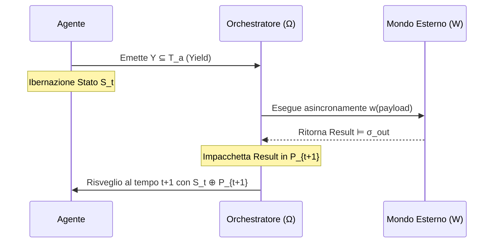

# 2.2 Principio di Isolamento dello Stato (State Isolation Invariant)

Questo documento formalizza la barriera architetturale tra l'ambiente esterno $W$ e la memoria interna dell'agente.

---

## 1. Il Teorema di Non-Invasività del Mondo

> **Invariante Fondamentale**: Nessun elemento $w \in W$ possiede puntatori, riferimenti o permessi di accesso in lettura o scrittura allo stato interno $S_t$ dell'agente.

$$\forall w \in W, \quad \frac{\partial S_t}{\partial w} = \emptyset$$

I tool esterni operano come funzioni puramente esogene o a scatola chiusa rispetto alla cognizione dell'agente.

---

## 2. Flusso di Retroazione Attraverso $\Omega$

L'unico canale di comunicazione tra il Mondo $W$ e lo stato dell'agente è mediato e controllato dall'Orchestratore $\Omega$:

Questo disaccoppiamento garantisce che il mondo esterno non possa mai corrompere la consistenza interna dell'agente se non attraverso l'esplicito filtro di instradamento $G_\Omega$.

