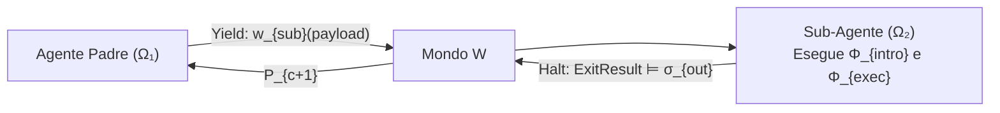

# 2.1 Il Registro degli Strumenti e le Firme Tipizzate

Questo documento descrive la formalizzazione del catalogo delle funzioni esterne $W$ e dei contratti di tipo.

---

## 1. Il Registro $W$

Il Mondo espone un insieme finito di interfacce azionabili:

$$W = \{ w_1, w_2, \dots, w_m \}$$

Ogni strumento fisico $w \in W$ rappresenta una computazione esogena con possibili effetti collaterali (API esterne, interrogazioni a database aziendali, invio di messaggi).

---

## 2. Firme Tipizzate Rigorose

Ciascun tool $w \in W$ è associato alla coppia di schemi $\langle \sigma_{in}, \sigma_{out} \rangle$:

$$w: (payload \models \sigma_{in}) \longrightarrow (Result \models \sigma_{out})$$

* **$\sigma_{in}$ (Schema di Pre-Condizione)**: Insieme dei vincoli strutturali e semantici che il payload inviato dall'agente deve necessariamente soddisfare affinché $\Omega$ ne autorizzi l'inoltro al mondo esterno.
* **$\sigma_{out}$ (Schema di Post-Condizione)**: Struttura garantita del risultato prodotto dal mondo esterno al termine della computazione asincrona.

Se un agente emette una richiesta per un tool con payload $x$ tale che $x \not\models \sigma_{in}$, $\Omega$ intercetta l'errore ed evita l'esecuzione dell'effetto collaterale.

---

## 3. Proprietà Frattale: Sub-Agenti come Funzioni del Mondo

Un corollario fondamentale di questo disaccoppiamento è la **natura frattale/ricorsiva del sistema**:

> **Teorema della Delega Tipizzata**: Una funzione fisica $w_{sub} \in W$ può corrispondere all'istanziazione e all'esecuzione completa di un **Sub-Agente**.

* **Firma del Sub-Agente**:
  - $\sigma_{in}$: Lo schema dei requisiti o del mandato assegnato dal padre.
  - $\sigma_{out}$: La Tagged Union dei contratti di terminazione del figlio: $\sigma_{out} = \coprod A_{term\_figlio}$.
* **Trasparenza Architetturale**: L'Agente Padre non deve gestire la complessità interna del figlio. Per il padre, invocare un sub-agente è formalmente indistinguibile da qualsiasi altra chiamata asincrona a un'API del Mondo $W$.

