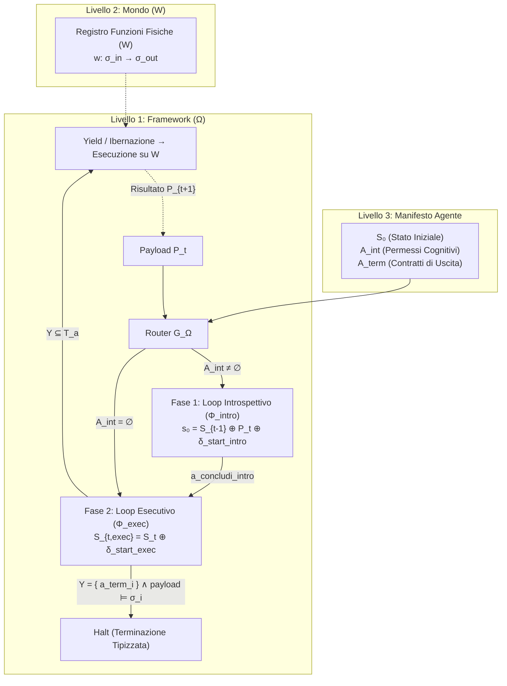

# Formalizzazione Matematica dei Sistemi Agentici

Benvenuto nella documentazione formale e architetturale del sistema agentico.
Il modello formalizza l'agente come un **Automa a Stati Finiti (FSM) fortemente tipizzato**, strutturato secondo il paradigma della **Componibilità a 3 Livelli**, in cui il motore di esecuzione, l'ambiente esterno/aziendale e l'identità dell'agente sono disaccoppiati.

---

## 🧭 Struttura Gerarchica e Modulare

Ogni concetto dispone di una sintesi rapida e di un proprio documento monografico di approfondimento:

1. [**01. Notazione e Simboli Matematici**](file:///c:/Users/aurel/Desktop/Progetti/Ricerca/Agent/formalization/01_notation.md)  
   Glossario e semantica formale di operatori ($\oplus, \models$), insiemi ($\Omega, W, \Delta$) e schemi ($\sigma$).

2. [**02. Livello 1: Il Framework (Motore Immutabile $\Omega$)**](file:///c:/Users/aurel/Desktop/Progetti/Ricerca/Agent/formalization/02_framework/README.md)  
   * [1.1 Universo Introspettivo ($A_{int\_universal}$)](file:///c:/Users/aurel/Desktop/Progetti/Ricerca/Agent/formalization/02_framework/introspective_universe.md)
   * [1.2 Funzione di Instradamento ($G_\Omega$)](file:///c:/Users/aurel/Desktop/Progetti/Ricerca/Agent/formalization/02_framework/router.md)
   * [1.3 Fase 1: Loop Introspettivo ($\Phi_{intro}$)](file:///c:/Users/aurel/Desktop/Progetti/Ricerca/Agent/formalization/02_framework/loop_intro.md)
   * [1.4 Fase 2: Loop Esecutivo ($\Phi_{exec}$)](file:///c:/Users/aurel/Desktop/Progetti/Ricerca/Agent/formalization/02_framework/loop_exec.md)
   * [1.5 Spazio delle Direttive del Framework ($\Delta$)](file:///c:/Users/aurel/Desktop/Progetti/Ricerca/Agent/formalization/02_framework/directives.md) *(include $\delta_{start\_intro}, \delta_{loop\_intro}, \delta_{start\_exec}$)*
   * [1.6 Operatore Algebrico di Fusione di Stato ($\oplus$)](file:///c:/Users/aurel/Desktop/Progetti/Ricerca/Agent/formalization/02_framework/fusion_operator.md)
   * [1.7 Ontologia dei Messaggi e del Flusso di Coscienza ($E_p$)](file:///c:/Users/aurel/Desktop/Progetti/Ricerca/Agent/formalization/02_framework/message_ontology.md) *(definisce ruoli $\Pi$, canali $\mathcal{K}$ e punti di accodamento)*
   * [1.8 Funzione di Visibilità delle Azioni ($\mathcal{V}_\Omega$)](file:///c:/Users/aurel/Desktop/Progetti/Ricerca/Agent/formalization/02_framework/visibility_function.md) *(maschera di capacità e azione $a_{abort\_call}$)*
   * [1.9 Funzione di Proiezione del Frame di Stato ($\mathcal{F}_\Omega$)](file:///c:/Users/aurel/Desktop/Progetti/Ricerca/Agent/formalization/02_framework/frame_projection.md) *(canale system e tripla fondamentale di inferenza $\mathcal{C}_\Omega$)*
   * [1.10 L'Automa a Stati Finiti Globale ($\mathcal{M}_{FSM}$)](file:///c:/Users/aurel/Desktop/Progetti/Ricerca/Agent/formalization/02_framework/fsm_states.md) *(diagramma unificato degli stati e matrice delle transizioni)*

3. [**03. Livello 2: Il Mondo (Dominio Aziendale / Esterno)**](file:///c:/Users/aurel/Desktop/Progetti/Ricerca/Agent/formalization/03_world/README.md)  
   * [2.1 Registro $W$ e Firme Tipizzate ($\sigma_{in}, \sigma_{out}$)](file:///c:/Users/aurel/Desktop/Progetti/Ricerca/Agent/formalization/03_world/tool_signatures.md)
   * [2.2 Teorema di Isolamento dello Stato](file:///c:/Users/aurel/Desktop/Progetti/Ricerca/Agent/formalization/03_world/state_isolation.md)

4. [**04. Livello 3: Il Manifesto dell'Agente**](file:///c:/Users/aurel/Desktop/Progetti/Ricerca/Agent/formalization/04_manifest/README.md)  
   * [3.1 Vettore Iniziale di Stato ($S_0$)](file:///c:/Users/aurel/Desktop/Progetti/Ricerca/Agent/formalization/04_manifest/initial_state.md)
   * [3.2 Matrice dei Permessi Cognitivi ($A_{int}$)](file:///c:/Users/aurel/Desktop/Progetti/Ricerca/Agent/formalization/04_manifest/cognitive_permissions.md)
   * [3.3 Contratti di Terminazione Tipizzati ($A_{term}$)](file:///c:/Users/aurel/Desktop/Progetti/Ricerca/Agent/formalization/04_manifest/termination_contracts.md)

5. [**05. Esempi e Tracce di Esecuzione**](file:///c:/Users/aurel/Desktop/Progetti/Ricerca/Agent/formalization/examples/order_discount_walkthrough.md)  
   * [Esempio 1: Gestione Ordini & Sconti](file:///c:/Users/aurel/Desktop/Progetti/Ricerca/Agent/formalization/examples/order_discount_walkthrough.md) *(Introspezione completa, K_a policy VIP, T_a montato dinamicamente, Yield multipli e Halt)*
   * [Esempio 2: Rilevatore di Lingua Reattivo](file:///c:/Users/aurel/Desktop/Progetti/Ricerca/Agent/formalization/examples/reactive_language_detector.md) *(Zero-Shot puro, Caso B di G_Ω, 1 solo tick e zero Yield)*
   * [Esempio 3: Disegnatore Geometrico su Tela](file:///c:/Users/aurel/Desktop/Progetti/Ricerca/Agent/formalization/examples/canvas_line_drawer_with_repairs.md) *(Iterativo con errore di schema sintattico, stato q_repair, correzione guidata δ_err_schema e compattazione memoria SOTA)*

6. [**06. Estensioni e Ricerca Futura**](file:///c:/Users/aurel/Desktop/Progetti/Ricerca/Agent/formalization/05_extensions/README.md)  
   Multi-agente, convergenza di $\Phi_{intro}$, algebra della memoria, ecc.

---

## 📐 Schema Architetturale di Sintesi

