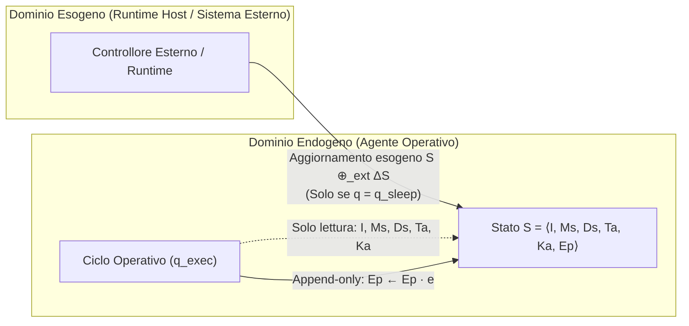

# 02. Spazio degli Stati ($S$) e Semantica di Mutabilità

Questo documento formalizza la struttura dello spazio degli stati $S$ dell'agente operativo, la definizione delle sue componenti e la dualità fondamentale tra **immutabilità endogena** e **mutabilità esogena**.

---

## 1. Definizione dello Spazio degli Stati

Lo stato globale $S$ dell'agente al generico istante computazionale è definito dalla 6-upla formale:

$$S = \langle I, \ M_s, \ D_s, \ T_a, \ K_a, \ E_p \rangle$$

Ciascuna coordinata risiede in uno spazio di tipi rigorosamente delimitato:

### 1.1 Coordinata $I$ — Identità dell'Agente
* **Tipo**: Record immutabile di specifiche ontologiche: $I \in \mathcal{I}$.
* **Definizione**: Rappresenta il nome, la personalità di sistema, lo stile relazionale e i confini ontologici dell'agente.
* **Esempio**:
  $$I = \{ \text{name}: \text{"SupportAgent"}, \ \text{tone}: \text{"concise\_technical"}, \ \text{role}: \text{"Customer Service Tier 2"} \}$$

### 1.2 Coordinata $M_s$ — Missione Operativa
* **Tipo**: Enunciato direttivo invariante: $M_s \in \mathcal{M}_{spec}$.
* **Definizione**: Obiettivo teleologico primario assegnato all'agente per l'intero ciclo vitale. Definisce la finalità delle decisioni operative e i criteri di accettazione dell'output.
* **Esempio**:
  $$M_s = \text{"Diagnosticare e risolvere disconnessioni di rete applicando le policy di troubleshooting."}$$

### 1.3 Coordinata $D_s$ — Mappa dei Dati Operativi Strutturati
* **Tipo**: Mappa associativa chiave-valore tipizzata: $D_s \in \mathcal{K}_{keys} \to \mathcal{V}_{values}$ (equivalente a un Record/Dizionario strutturato JSON).
* **Definizione**: Memoria dati di lavoro e contesto operativo strutturato. Contiene variabili operative, parametri di sessione, identificativi di contesto (es. ID utente, ID transazione, tenant), flag di ambiente o configurazioni di runtime utili all'esecuzione del compito.
* **Esempio**:
  $$D_s = \{ \text{"user\_id"}: \text{"USR-9481"}, \ \text{"environment"}: \text{"production"}, \ \text{"retry\_budget"}: 3, \ \text{"flags"}: \{ \text{"dry\_run"}: \text{false} \} \}$$

### 1.4 Coordinata $T_a$ — Registro dei Tool Fisici Attivi
* **Tipo**: Mappa di definizioni formali di tool fisici: $T_a \subset \mathcal{W}_{tools}$.
* **Definizione**: Insieme delle firme di chiamata e schemi di validazione $(\sigma_{in}, \sigma_{out})$ dei tool del mondo esterno che l'agente è abilitato a invocare.
* **Rappresentazione**:
  $$T_a = \{ \text{ping\_host}(\sigma_{in}, \sigma_{out}), \ \text{restart\_service}(\sigma_{in}, \sigma_{out}), \ \dots \}$$

### 1.5 Coordinata $K_a$ — Buffer dei Concetti e Conoscenze Attive
* **Tipo**: Buffer semantico indicizzato: $K_a \in \mathcal{K}_{buffer}$.
* **Definizione**: Insieme di definizioni di dominio, manuali tecnici sintetizzati o schemi operativi pre-caricati per garantire contestualizzazione semantica immediata.

### 1.6 Coordinata $E_p$ — Traccia degli Eventi Episodici
* **Tipo**: Sequenza finita ordinata (vettore cronologico) di messaggi: $E_p \in \mathcal{M}_{msg}^*$.
* **Definizione**: Cronistoria completa di tutti gli scambi comunicativi e delle interazioni fisiche occorse: input utente, deliberazioni, chiamate a tool e rispettivi risultati.

---

## 2. Il Principio di Immutabilità Endogena

Dall'interno del runtime dell'agente operativo, le coordinate semantiche e strutturali sono **rigidamente non modificabili**:

$$\forall a \in \Sigma, \quad a(I, M_s, D_s, T_a, K_a) = (I, M_s, D_s, T_a, K_a)$$

### Implicazioni Operative:
1. **Assenza di Auto-Modifica Diretta**: L'agente operativo non dispone di alcuna primitiva o tool per alterare la propria identità ($I$), riformulare la propria missione ($M_s$), modificare direttamente la mappa dei dati operativi ($D_s$), registrare nuovi tool nel proprio set ($T_a$) o aggiungere concetti al buffer ($K_a$).
2. **Unico Grado di Libertà Endogeno ($E_p$)**: L'unica mutazione di stato che l'agente operativo può generare durante il suo ciclo di esecuzione è l'avanzamento monotono della traccia episodica mediante operatore di accodamento:
   $$E_p \leftarrow E_p \cdot e$$
3. **Prevenzione del Degrado Cognitivo**: L'immutabilità endogena garantisce che l'agente non possa de-sincronizzare la propria missione o erodere i propri vincoli di sicurezza a causa di allucinazioni o errori durante l'esecuzione operativa.

---

## 3. Il Principio di Mutabilità Esogena ($\oplus_{ext}$)

Sebbene l'agente non possa alterare se stesso, le sue componenti non sono metafisicamente statiche per l'eternità: esse sono **esogenamente mutabili**.

Un'entità o runtime di controllo esterno può modificare lo stato dell'agente applicando un operatore algebrico di aggiornamento esogeno:

$$S' = S \oplus_{ext} \Delta S$$

Dove $\Delta S = \langle \Delta I, \Delta M_s, \Delta D_s, \Delta T_a, \Delta K_a, \emptyset \rangle$.

### Regole Assiomatiche di Aggiornamento Esogeno:
1. **Vincolo di Stato di Quiete (Quiescence Invariant)**:
   L'aggiornamento esogeno può avvenire **esclusivamente** quando l'agente si trova nello stato di ibernazione $q_{sleep}$:
   $$\text{Apply}(S \oplus_{ext} \Delta S) \implies q = q_{sleep}$$
   È formalmente vietato applicare un aggiornamento $\oplus_{ext}$ mentre l'agente si trova in stato di esecuzione ($q_{exec}$), attesa asincrona ($q_{yield}$) o riparazione ($q_{repair}$).
2. **Trasparenza Epistemica**: L'agente operativo sperimenta la modifica semplicemente come il nuovo stato di realtà al proprio successivo risveglio:
   $$S_{nuovo} = \langle I', M_s', D_s', T_a', K_a', E_p \rangle$$
   La traccia episodica pregressa $E_p$ è preservata a meno che il controllore esterno non decida esplicitamente di compattarla o troncarla.

