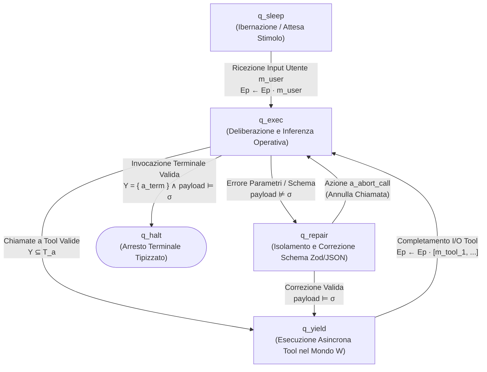

# 03. L'Automa a Stati Finiti ($\mathcal{M}_{FSM}$)

Questo documento formalizza il motore di controllo dell'Agente Operativo come un **Automa a Stati Finiti (Finite State Machine)** deterministico e fortemente tipizzato.

---

## 1. Definizione della Macchina a Stati

L'automa è espresso dalla 6-upla:

$$\mathcal{M}_{FSM} = \langle \mathcal{Q}, \Sigma_{in}, \Sigma_{out}, \delta_{trans}, q_{sleep}, \{ q_{halt} \} \rangle$$

Dove:
* **$\mathcal{Q}$**: Insieme discreto degli stati di controllo:
  $$\mathcal{Q} = \{ q_{sleep}, \ q_{exec}, \ q_{yield}, \ q_{repair}, \ q_{halt} \}$$
* **$\Sigma_{in}$**: Spazio degli ingressi (Messaggi utente $m_{user}$, output del modello neurale $\mathbb{M}(\mathcal{C}_\Omega)$, esiti asincroni dei tool dal mondo $W$).
* **$\Sigma_{out}$**: Spazio delle uscite (Invocazioni fisiche verso $W$, emissione del risultato terminale $ExitResult$).
* **$\delta_{trans}$**: Funzione di transizione di stato $\mathcal{Q} \times \Sigma_{in} \to \mathcal{Q}$.
* **$q_{sleep}$**: Stato iniziale di riposo e ibernazione.
* **$q_{halt}$**: Stato terminale assorbente (conclusione definitiva del macro-ciclo operativo).

---

## 2. Definizione Dettagliata degli Stati ($\mathcal{Q}$)

### 2.1 $q_{sleep}$ — Stato di Ibernazione e Quiete
* **Natura**: Passivo / Ibernato.
* **Semantica**: L'agente non consuma cicli computazionali né token. Lo stato $S$ è serializzato in memoria persistente.
* **Eventi Ammissibili**:
  1. Arrivo di un nuovo messaggio esogeno dell'utente $m_{user} \in \Sigma_{in}$.
  2. Ricezione di un aggiornamento esogeno di stato $\oplus_{ext} \Delta S$.
* **Invariante**: Nessun tool o inferenza neurale è attiva durante $q_{sleep}$.

### 2.2 $q_{exec}$ — Stato di Esecuzione Operativa
* **Natura**: Attivo / Deliberativo.
* **Semantica**: L'agente formula la tripla $\mathcal{C}_\Omega$, interroga il modello linguistico $\mathbb{M}$ e delibera le azioni operative da compiere.
* **Comportamento dell'Orchestratore**:
  - Calcola la visibilità $\mathcal{V}_\Omega(q_{exec}) = T_a \cup A_{term}$.
  - Esegue l'inferenza $\mathbb{M}(\mathcal{C}_\Omega) \to \langle \text{thought}^?, \mathcal{A}_{calls} \rangle$.
  - Valida la conformità di ogni chiamata rispetto allo schema formale: $\forall a \in \mathcal{A}_{calls}, \ payload \models \sigma_{in}(a)$.
* **Uscite Possibili**:
  - Se $\mathcal{A}_{calls} \subseteq T_a$ (chiamate valide a tool di mondo): transizione verso $q_{yield}$.
  - Se $\mathcal{A}_{calls} = \{ a_{term} \}$ con $payload \models \sigma(a_{term})$: transizione verso $q_{halt}$.
  - Se $\exists a \in \mathcal{A}_{calls} : payload \not\models \sigma(a)$ (violazione di tipo): transizione verso $q_{repair}$.

### 2.3 $q_{yield}$ — Sospensione Asincrona per Chiamate al Mondo
* **Natura**: Attesa I/O asincrono.
* **Semantica**: L'Orchestratore $\Omega_{op}$ inoltra il blocco delle chiamate validate verso il runtime del Mondo Fisico $W$. L'esecuzione del modello è sospesa fino alla ricezione di tutti gli esiti.
* **Postcondizione**: Al completamento dei tool, gli esiti vengono formattati come messaggi canonicamente tipizzati di ruolo `tool`, concatenati alla sequenza $E_p$, e l'automa transita nuovamente a $q_{exec}$.

### 2.4 $q_{repair}$ — Stato di Riparazione Schema e Sintassi
* **Natura**: Recupero / Correzione controllata.
* **Semantica**: Si attiva qualora il modello generi parametri non conformi agli schemi Zod, JSON non parsabile o invochi identificatori inesistenti.
* **Isolamento delle Capacità**: La funzione di visibilità viene ristretta a:
  $$\mathcal{V}_\Omega(q_{repair}) = \{ a_{target}, \ a_{abort\_call} \}$$
* **Risoluzione**:
  - Se il modello fornisce argomenti corretti $payload \models \sigma(a_{target})$, la chiamata viene validata e si prosegue verso l'esecuzione ordinaria.
  - Se il modello emette $a_{abort\_call}$, la chiamata errata viene cancellata e l'agente torna immediatamente a deliberare in $q_{exec}$.

### 2.5 $q_{halt}$ — Stato Terminale Assorbente
* **Natura**: Terminale assorbente.
* **Semantica**: Raggiunto quando l'agente seleziona con successo una delle azioni contrattuali di terminazione $a_{term} \in A_{term}$.
* **Invariante**:
  $$\forall e \in \Sigma_{in}, \quad \delta_{trans}(q_{halt}, e) = q_{halt}$$
* **Esito**: L'Orchestratore estrae il payload validato del contratto di uscita, produce l'evento di risposta per l'utente, e dealloca o iberna il runtime.

---

## 3. Diagramma di Transizione degli Stati

---

## 4. Matrice Formale delle Transizioni ($\delta_{trans}$)

| Stato Attuale ($q$) | Evento Trigger | Condizione di Guardia | Stato Successivo ($q'$) | Azione dell'Orchestratore $\Omega_{op}$ |
| :--- | :--- | :--- | :--- | :--- |
| **$q_{sleep}$** | Arrivo $m_{user}$ | Payload utente valido | **$q_{exec}$** | Accoda $E_p \leftarrow E_p \cdot m_{user}$, inizializza contesto computazionale. |
| **$q_{exec}$** | Emissione $\mathcal{A}_{calls}$ | $\mathcal{A}_{calls} \subseteq T_a \land \forall a \in \mathcal{A}, p_a \models \sigma_a$ | **$q_{yield}$** | Accoda messaggio `assistant` con `tool_calls` in $E_p$; dispatch parallelo su $W$. |
| **$q_{exec}$** | Emissione $\mathcal{A}_{calls}$ | $\exists a \in \mathcal{A}_{calls} : p_a \not\models \sigma_a$ | **$q_{repair}$** | Registra errore in $E_p$ tramite messaggio nativo `tool`; isola visibilità. |
| **$q_{exec}$** | Emissione $\mathcal{A}_{calls}$ | $\mathcal{A}_{calls} = \{ a_{term} \} \land p \models \sigma(a_{term})$ | **$q_{halt}$** | Valida contratto terminale; estrae output; arresto immediato del loop. |
| **$q_{yield}$** | Ricezione esiti $R$ | Tutte le chiamate parallele hanno restituito esito | **$q_{exec}$** | Accoda tutti i messaggi `tool` in $E_p$; prepara nuova deliberazione. |
| **$q_{repair}$** | Emissione riparata | $p_{new} \models \sigma(a_{target})$ | **$q_{yield}$** | Aggiorna la chiamata valida; invia in esecuzione su $W$. |
| **$q_{repair}$** | Emissione di $a_{abort\_call}$ | $a = a_{abort\_call}$ | **$q_{exec}$** | Accoda annullamento; ripristina la visibilità ordinaria $\mathcal{V}_\Omega(q_{exec})$. |
| **$q_{halt}$** | Qualsiasi evento | Sempre vero | **$q_{halt}$** | Stato assorbente invariante. Processo terminato con successo. |

