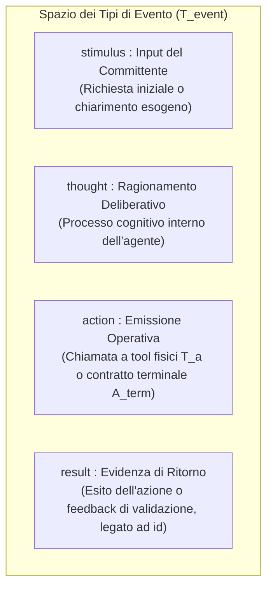

# 06. Ontologia degli Eventi Epistemici e Traccia Episodica ($E_p$)

Questo documento formalizza la struttura atomica degli eventi, lo spazio dei tipi di evento ($\mathcal{T}_{event}$), la traccia episodica $E_p$ e il protocollo tipizzato di ritorno degli errori.

---

## 1. Definizione Atomica di un Evento Epistemico ($e$)

La traccia episodica $E_p$ è una sequenza finita e temporalmente ordinata di eventi discreti fortemente tipizzati:

$$E_p = [e_0, \ e_1, \ e_2, \ \dots, \ e_n] \in \mathcal{E}^*$$

Ogni singolo evento $e \in \mathcal{E}$ è formalizzato come la 4-upla essenziale:

$$e = \langle \tau, \ \text{type}, \ \mu, \ id \rangle$$

| Componente | Simbolo | Dominio / Tipo | Descrizione |
| :--- | :---: | :--- | :--- |
| **Marca Temporale** | $\tau$ | $\mathbb{N}_0 \times \mathbb{N}_0$ | Coppia $\langle c, t \rangle$ indicante il macro-ciclo del task $c$ e il tick deliberativo interno $t$. |
| **Tipo di Evento** | $\text{type}$ | $\mathcal{T}_{event}$ | Classificazione funzionale ed epistemica dell'evento: $\{\text{stimulus}, \text{thought}, \text{action}, \text{result}\}$. |
| **Payload Semantico** | $\mu$ | $\text{Text} \cup \text{ActionPayload} \cup \text{ResultPayload}$ | Contenuto informativo, deliberativo o strutturato associato all'evento. |
| **ID di Correlazione** | $id$ | $\mathcal{I} \cup \{\emptyset\}$ | Identificativo univoco di pairing per correlare deterministicamente azioni ed esiti. |

---

## 2. Lo Spazio dei Tipi di Evento ($\mathcal{T}_{event}$)

Lo spazio discreto dei tipi di evento è formalmente partizionato in:

$$\mathcal{T}_{event} = \{ \text{stimulus}, \ \text{thought}, \ \text{action}, \ \text{result} \}$$

### 2.1 Tipo `stimulus`
* **Origine**: Committente esterno / Utente / Sistema chiamante.
* **Semantica**: Rappresenta l'input esogeno che innesca o alimenta il compito dell'agente.
* **Struttura**: $\langle \tau, \text{stimulus}, \mu_{text}, \emptyset \rangle$.

### 2.2 Tipo `thought`
* **Origine**: Mente dell'agente.
* **Semantica**: Rappresenta il processo di pianificazione e analisi logica interna (Chain of Thought). È privo di effetti collaterali diretti sul mondo.
* **Struttura**: $\langle \tau, \text{thought}, \mu_{text}, \emptyset \rangle$.

### 2.3 Tipo `action`
* **Origine**: Mente dell'agente.
* **Semantica**: Rappresenta l'atto operativo formale deliberato dall'agente. Può consistere in un vettore di chiamate a tool del mondo fisico $Y \subseteq T_a$ oppure in una singola chiamata a un contratto terminale $a_{term} \in A_{term}$.
* **Struttura**: $\langle \tau, \text{action}, \mathcal{A}_{calls}, id \rangle$.

### 2.4 Tipo `result`
* **Origine**: Mondo fisico $W$ o Orchestratore $\Omega_{op}$.
* **Semantica**: Rappresenta l'esito fattuale di un'azione precedentemente emessa o il responso formale di validazione. È obbligatoriamente vincolato all'$id$ della chiamata corrispondente.
* **Struttura**: $\langle \tau, \text{result}, \mu_{result}, id \rangle$.

---

## 3. Protocollo Formale di Notifica degli Errori su Tipo `result`

Sia $a \in \mathcal{V}_\Omega(q)$ un'azione invocata con payload $p$ e contrassegnata dall'identificativo $id$. Qualora la verifica contrattuale fallisca:

$$p \not\models \sigma_{in}(a)$$

l'Orchestratore $\Omega_{op}$ genera deterministicamente un evento di tipo **`result`** associato al medesimo $id$:

$$e_{err} = \langle \tau, \ \text{result}, \ \mu_{err}, \ id \rangle$$

Il payload semantico di errore $\mu_{err}$ è formalizzato come elemento dello spazio degli errori $\mathcal{E}_{error}$, conforme allo schema contrattuale di diagnostica $\sigma_{error}$:

$$\mu_{err} \models \sigma_{error}, \quad \mu_{err} = \langle c_{err}, \ \delta_{diag}, \ \sigma_{in}(a) \rangle$$

Dove:
* **$c_{err} \in \mathcal{C}_{error}$**: Classe tassonomica della violazione (ad esempio errore di decodifica sintattica, violazione di vincolo di tipo, o omissione di attributo obbligatorio).
* **$\delta_{diag}$**: Diagnostica formale della divergenza tra il valore fornito e il dominio ammesso dallo schema.
* **$\sigma_{in}(a)$**: Definizione formale dello schema atteso, resa disponibile all'agente come evidenza di allineamento contrattuale.

---

## 4. Invarianti della Sequenza Episodica ($E_p$)

L'Orchestratore $\Omega_{op}$ garantisce che la sequenza temporale $E_p$ rispetti i seguenti invarianti algebrici:

### Invariante 1: Correlazione Biunivoca delle Azioni
Per ogni evento $e \in E_p$ con $\text{type} = \text{action}$ e identificativo $id \neq \emptyset$, deve esistere un corrispondente evento successivo $e' \in E_p$ con $\text{type} = \text{result}$ recante il medesimo identificativo:

$$\forall e \in E_p \ (\text{type}(e) = \text{action} \land e.id \neq \emptyset) \implies \exists! e' \in E_p \ (\text{type}(e') = \text{result} \land e'.id = e.id)$$

### Invariante 2: Monotonia Temporale
La marca temporale $\tau = \langle c, t \rangle$ cresce monotonicamente:
$$\tau(e_{k+1}) \ge \tau(e_k), \quad \forall k \ge 0$$

### Invariante 3: Accodamento Deterministico
L'avanzamento della traccia avviene esclusivamente tramite operatore di concatenazione:
$$E_p^{(k+1)} = E_p^{(k)} \cdot e$$
Nessun evento pregresso può essere rimosso o alterato durante l'esecuzione operativa.
