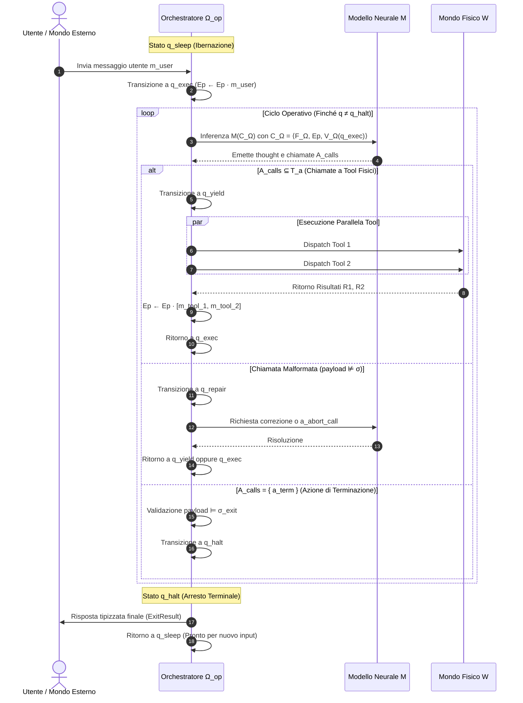

# 07. Meccanica delle Transizioni e Ciclo Esecutivo

Questo documento formalizza la funzione di transizione passo-passo $\delta_{trans}$, il ciclo di vita dell'esecuzione e la semantica del parallelismo nei tool del mondo fisico.

---

## 1. Il Ciclo di Vita Operativo

Il ciclo esecutivo dell'agente si sviluppa attraverso fasi distinte governate deterministicamente dall'Orchestratore $\Omega_{op}$:

---

## 2. Dispatching Parallelo dei Tool ($q_{yield}$)

Quando l'agente delibera un insieme di azioni fisiche $Y = \{ t_1, t_2, \dots, t_k \} \subseteq T_a$, l'Orchestratore $\Omega_{op}$ applica la semantica di esecuzione concorrente:

1. **Esecuzione Asincrona Parallela**:
   Le chiamate a tool deliberate nel turno vengono inoltrate simultaneamente al runtime del mondo fisico:
   $$\text{Future}_i = \text{ExecuteAsync}(t_i, payload_i), \quad \forall i \in \{1, \dots, k\}$$
2. **Attesa Collettiva (Barrier Synchronization)**:
   L'automa rimane in $q_{yield}$ fino al completamento di tutte le chiamate pendenti:
   $$R = \text{AwaitAll}(\text{Future}_1, \dots, \text{Future}_k)$$
3. **Linearizzazione degli Esiti in $E_p$**:
   I risultati vengono serializzati rispettando rigidamente i corrispondenti `tool_call_id` e concatenati ad $E_p$ prima di transitare nuovamente a $q_{exec}$.

---

## 3. Risoluzione della Terminazione e Halt ($q_{halt}$)

Il ciclo operativo termina **esclusivamente** quando l'agente esegue una chiamata valida a un contratto terminale $a_{term} \in A_{term}$:

$$\mathcal{A}_{calls} = \{ a_{term} \} \quad \land \quad a_{term}.payload \models \sigma_{exit}(a_{term})$$

Al verificarsi di tale condizione:
1. L'Orchestratore sigilla la traccia $E_p$.
2. Estrae il payload di risposta conforme a $\sigma_{exit}$.
3. Emette il risultato verso il chiamante esterno.
4. L'automa transita a $q_{halt}$. Se il runtime è persistente, l'agente viene riposizionato in $q_{sleep}$ pronto a recepire future interazioni.

