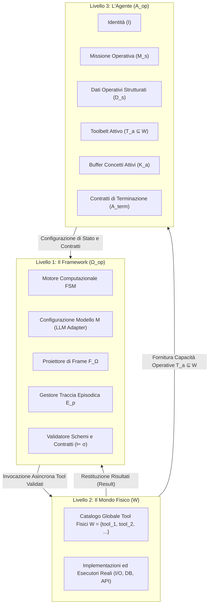

# 08. L'Architettura Componibile a 3 Livelli

Questo documento formalizza l'architettura sistemica del Framework per Agenti Operativi ($\Omega_{op}$), strutturata secondo un paradigma di **disaccoppiamento ortogonale a tre livelli**: il Framework di esecuzione, il Mondo fisico e l'Agente.

---

## 1. Schema Generale dei Tre Livelli

L'intero sistema è formalizzato come la composizione di tre entità distinte con responsabilità rigorosamente delimitate:

$$\text{System} = \langle \text{Livello 1: Framework } (\Omega_{op}), \ \text{Livello 2: Mondo } (W), \ \text{Livello 3: Agente } (A_{op}) \rangle$$

---

## 2. Livello 1: Il Framework ($\Omega_{op}$)

Il primo livello costituisce il **motore invariante di esecuzione e controllo**. Non contiene logiche di business specifiche di una singola applicazione né la personalità di un agente; racchiude le regole universali del runtime.

### Componenti Fondamentali:
1. **L'Automa a Stati Finiti ($\mathcal{M}_{FSM}$)**:
   Governa rigidamente le transizioni tra gli stati $\mathcal{Q} = \{ q_{sleep}, q_{exec}, q_{yield}, q_{repair}, q_{halt} \}$.
2. **Il Validatore di Conformità Tipizzata ($\models$)**:
   Verifica che ogni azione emessa dall'agente rispetti lo schema contrattuale $\sigma_{in}$ prima che qualsiasi esecuzione fisica possa avvenire.
3. **Il Gestore della Traccia Episodica ($E_p$)**:
   Gestisce la sequenza ordinata degli eventi $e = \langle \tau, \text{type}, \mu, id \rangle$, l'indicizzazione temporale e il protocollo di notifica nativa degli errori su tipo `result`.
4. **La Funzione di Proiezione del Frame ($\mathcal{F}_\Omega$)**:
   Sintetizza in modo deterministico le componenti dello stato dell'agente nel canale di sistema.

### Parametri di Attivazione e Configurazione:
Per rendere il Framework completo e operativo, devono essere forniti i seguenti parametri di configurazione del runtime:
* **$\mathbb{M}$**: Configurazione del trasduttore neurale (istanza dell'adapter di inferenza, endpoint del modello, parametri di sampling).
* **$\text{Policy}_{ephemeral}$**: Regola di conservazione o esclusione del blocco `thought` nella memoria episodica $E_p$.
* **$\text{Renderer}_{\mathcal{F}}$**: La specifica funzione o template di rendering adottata per proiettare il frame di sistema.

---

## 3. Livello 2: Il Mondo Fisico ($W$)

Il secondo livello modella l'**ambiente esterno reale** con cui l'agente può interagire.

### Definizione del Registro:
Il Mondo è formalizzato come un registro aperto di strumenti fisici:

$$W = \{ w_1, \ w_2, \ \dots, \ w_m \}$$

Ciascun tool $w \in W$ è definito dalla tupla:

$$w = \langle \text{id}, \ \text{name}, \ \sigma_{in}, \ \sigma_{out}, \ \text{description}, \ \text{executor} \rangle$$

* **$\sigma_{in}, \sigma_{out}$**: Contratti di tipo rigidi per input e output.
* **$\text{description}$**: Descrizione funzionale del comportamento dello strumento.
* **$\text{executor}$**: L'implementazione tangibile della funzione (chiamata HTTP, query SQL, comando di sistema, operazione I/O asincrona).

### Proprietà di Isolamento del Mondo:
Il Mondo Fisico è **completamente agnostico** rispetto alla struttura interna dell'agente. Riceve parametri già validati dall'Orchestratore, esegue l'operazione in modo asincrono e restituisce il risultato conforme a $\sigma_{out}$.

---

## 4. Livello 3: L'Agente ($A_{op}$)

Il terzo livello definisce la **specifica concreta dell'agente operativo**, ovvero l'entità che viene istanziata per risolvere uno specifico dominio di problemi.

L'agente è interamente specificato dalla configurazione del proprio stato e dai propri contratti di interazione:

$$A_{op} = \langle I, \ M_s, \ D_s, \ T_a, \ K_a, \ A_{term} \rangle$$

### Componenti della Specifica dell'Agente:
1. **$I$ (Identità)**: Definizione ontologica di nome, ruolo e registro comunicativo.
2. **$M_s$ (Missione Operativa)**: Scopo teleologico primario e criteri operativi assegnati all'agente.
3. **$D_s$ (Mappa dei Dati Operativi Strutturati)**: Variabili di contesto, identificativi di sessione o configurazioni di runtime iniziali.
4. **$T_a \subseteq W$ (Toolbelt Attivo)**: Il sottoinsieme di strumenti del Mondo Fisico ($W$) che questo specifico agente è autorizzato a utilizzare.
5. **$K_a$ (Buffer Concetti Attivi)**: Il corpo di conoscenze semantiche, procedure o documentazione di dominio pre-caricato a disposizione dell'agente.
6. **$A_{term}$ (Contratti di Terminazione)**: L'insieme delle porte di uscita tipizzate tramite cui l'agente restituisce l'esito finale al chiamante e decreta l'arresto ($q_{halt}$).

---

## 5. Meccanica di Integrazione e Componibilità

La separazione a tre livelli assicura una completa modularità e riusabilità:

1. **Indipendenza del Framework da Agente e Mondo**:
   Il medesimo Framework ($\Omega_{op}$) governa indifferentemente qualsiasi tipologia di agente e qualsiasi insieme di tool fisici.
2. **Indipendenza del Mondo dall'Agente**:
   I tool in $W$ sono servizi riutilizzabili condivisi; diversi agenti possono accedere a sottoinsiemi diversi del mondo ($T_a^{(1)} \subseteq W$, $T_a^{(2)} \subseteq W$).
3. **Dichiaratività dell'Agente**:
   Creare o riconfigurare un agente non richiede la riscrittura dell'automa o del motore di esecuzione: consiste unicamente nel fornire la specifica dichiarativa di Livello 3 $\langle I, M_s, D_s, T_a, K_a, A_{term} \rangle$.
